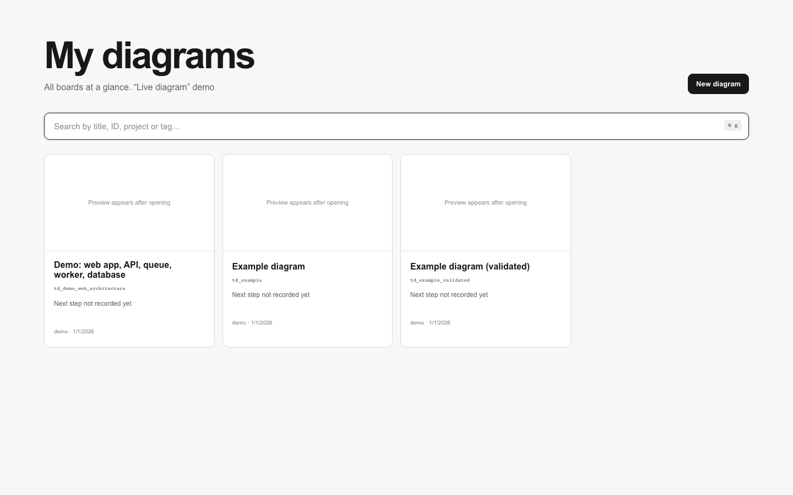
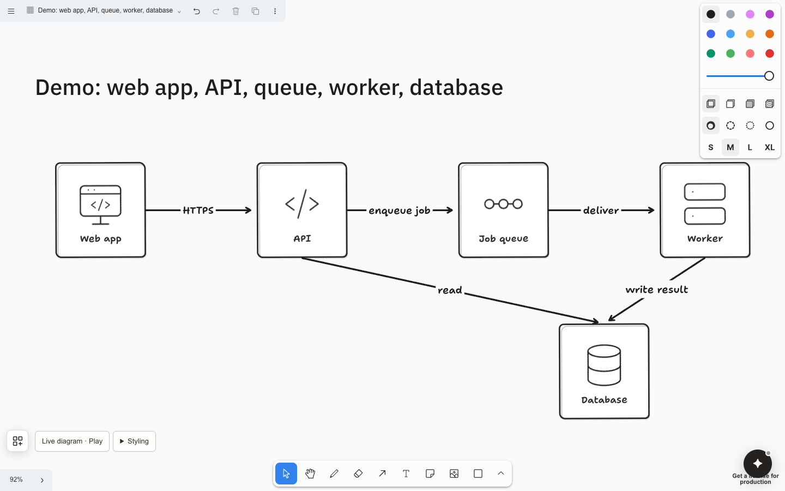
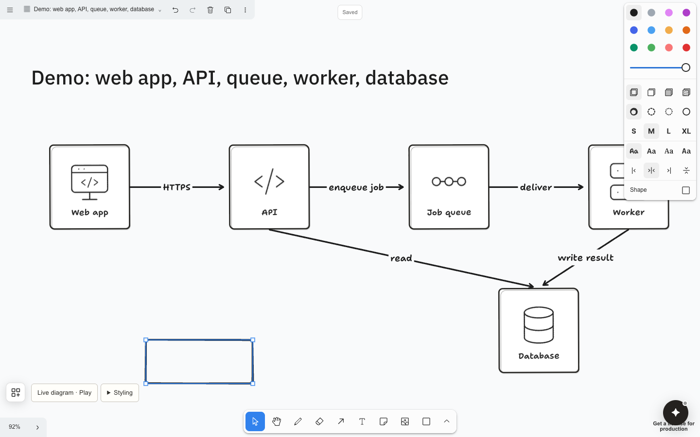
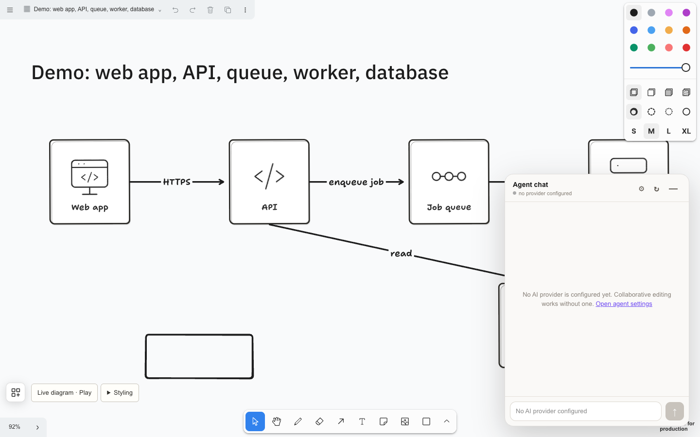
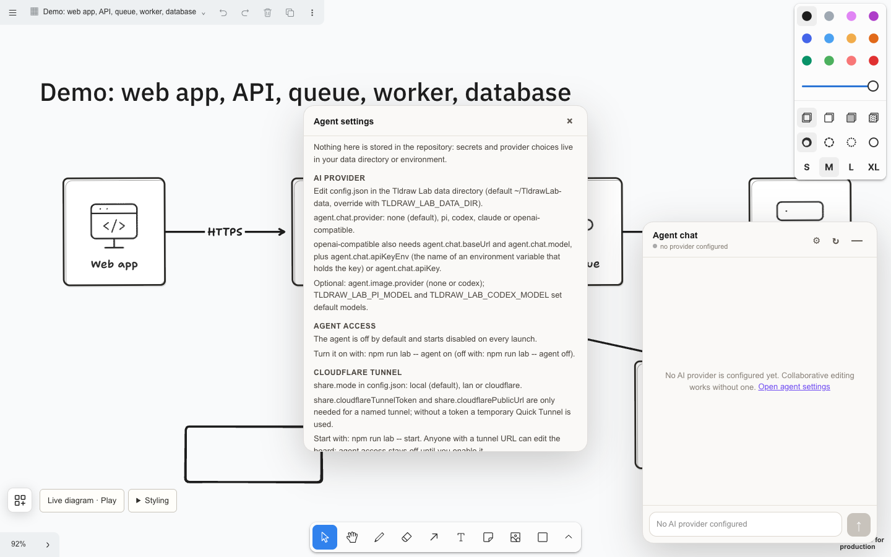

# Tldraw Lab

A local, realtime whiteboard for editable diagrams, built on the [tldraw SDK](https://tldraw.dev). Describe a diagram as JSON and the app lays it out as normal, editable tldraw shapes. A command-line tool lets scripts and agents create and patch diagrams by stable ID, and an optional chat panel lets an AI agent change a board.

**Status: preview.** It is a personal tool that works on macOS and Node 22. It is not a supported product, and the interfaces may change. Everything below works with the bundled demo boards and no paid keys.

## Features

- Editable tldraw canvas with custom shapes: cards, service cards, an icon and asset library, a spreadsheet shape and an experimental animated "live frame".
- Diagram specs (`tldraw-lab/v1`: nodes, edges, sequence diagrams, tables). See [DIAGRAM_SPEC.md](DIAGRAM_SPEC.md).
- A workspace of boards with stable IDs and direct URLs (`/d/<id>`), a board switcher, a command palette (`Cmd+K`) and a focus mode.
- Realtime sync between browsers on the same board through `@tldraw/sync` and a local Durable Object run by Wrangler/Miniflare.
- Local storage in one data directory: SQLite state, a self-contained `.tldr` copy of every board, and periodic revision snapshots.
- Optional: an agent chat, a Cloudflare tunnel for sharing, and a native macOS shell. All are off by default.

## Getting started

Prerequisites:

- Node.js 22.13 or newer (`engines` is `>=22.13.0`, so newer majors work too; `.nvmrc` pins 22 and with nvm you run `nvm use`)
- npm 10 or newer (it ships with Node 22)
- Optional, only for the macOS wrapper: macOS with the Xcode command line tools

```bash
git clone <repository-url> tldraw-lab
cd tldraw-lab
npm run setup   # checks Node and npm, then runs npm ci
npm start       # starts the app and prints its URL
```

`npm run setup` stops with a message saying what to fix if Node or npm is too old. Open the printed URL (for example `http://localhost:3000/`). If port 3000 is busy, `npm start` picks the next free port and prints it. To choose one: `npm start -- --port 5173`. `npm ci` may print `npm audit` warnings from transitive dependencies; they do not affect the local app.

Boards, config and snapshots are stored in `~/TldrawLab-data`. Set `TLDRAW_LAB_DATA_DIR` to use another folder, for example a throwaway one while trying the app.

> `npm start` runs the development server on purpose. The production server (`vinext start`) is a plain Node process without the Durable Object binding that the sync and workspace routes need, so `/api/workspace` returns 500 there.

## Two-minute walkthrough

1. **Open the workspace.** `/` lists the three demo boards.

   

2. **Open a board.** Click "Demo: web app, API, queue, worker, database", or go straight to `/d/td_demo_web_architecture`. It is an ordinary tldraw board, so every shape can be moved and edited.

   

3. **Edit.** Draw or drag a shape. Changes are saved automatically and shared with every browser that has the same board open. Reload the page and the board stays as you left it.

   

4. **Open the agent chat.** The round button at the bottom right opens the chat. Without a provider it says so and keeps working as a plain whiteboard.

   

5. **See where integrations are configured.** "Open agent settings" lists the config names for the AI provider and the Cloudflare tunnel. Nothing is stored in the repository.

   

To create and patch boards from scripts, see [Agent CLI](#agent-cli).

Screenshots were captured from a throwaway data directory with the bundled demo boards.

## Architecture

```text
app/            Next.js App Router app, served by vinext (Vite)
  domain/       shape utils, asset catalog, icons, spec loaders, templates
  io/           browser storage: workspace API client, thumbnails, assets, CSV, downloads
  state/        React hooks: workspace documents, editor session, import/export, agent patches
  ui/           workspace library, board switcher, menus, agent chat and settings, mascot
  styles/       CSS split by area
worker/         Cloudflare Worker + Durable Object: sync rooms and the workspace index
scripts/        launcher (lab.mjs), agent bridge, CLIs, storage routes, checks
  lib/          config, provider calls, board storage, data migration
macos/          optional Swift/AppKit shell around the local server
public/         demo boards, technology icons, mascot sprites
tests/          node:test suites
```

Layers import in one direction: `ui` to `state` to `domain` to `io`. The browser talks to the worker through `/api/workspace` and `/api/connect/<room>`; the dev server adds local-only `/api/lab/*` routes for revisions and snapshots (`scripts/lab-storage-plugin.mjs`).

## Agent CLI

The CLI keeps agent-created boards as source specs in the checkout: `public/diagrams/<id>.diagram.json` plus the index `public/workspace/index.json`, which the dev server serves to the app. The first time you open such a board, the app seeds its realtime room from the spec; after that the room, saved in the data directory, is the live copy. `patch` edits the source spec, so it only affects a board that has not been opened yet. To change an opened board, use the layout preflight below. Boards you create in the browser live only in the data directory. Documents are addressed by ID.

The commands print links for the running app. They use `http://localhost:3000` by default; if `npm start` picked another port, set `TLDRAW_LAB_URL` to the URL it printed (the same variable is used by `npm run test:live`):

```bash
export TLDRAW_LAB_URL=http://localhost:5173
npm run workspace -- list
npm run workspace -- show <id>
npm run workspace -- create public/diagrams/demo-web-architecture.diagram.json --title "My diagram" --project "demo"
npm run workspace -- patch <id> patch.json
npm run workspace -- open <id>           # opens the board in the default browser on macOS; add --print to only print the URL
```

`create` needs a `tldraw-lab/v1` spec; any file in `public/diagrams` is a working sample. The board title also becomes the heading on the canvas. `patch.json` accepts `metadata`, a full replacement `spec`, or incremental `addNodes` and `addEdges`.

To align a board that is already open with a layout, use the layout preflight, which drives a real tldraw `Editor` in a headless browser (needs Chrome; set `CHROME_PATH` if it is not found). The example config targets a board created from the demo spec above and changes the live board:

```bash
npm run workspace:layout -- <id> examples/layout/compact-columns.json /tmp/layout-preflight
```

## Docs

- [DIAGRAM_SPEC.md](DIAGRAM_SPEC.md): the spec format
- [DIAGRAM_ROUTER.md](DIAGRAM_ROUTER.md): edge routing rules
- [LAYOUT_GUIDE.md](LAYOUT_GUIDE.md) and [SEQUENCE_LAYOUT_GUIDE.md](SEQUENCE_LAYOUT_GUIDE.md): layout rules
- [VISUAL_STYLE_GUIDE.md](VISUAL_STYLE_GUIDE.md): visual style
- [WORKSPACE_LAYOUT_PREFLIGHT.md](WORKSPACE_LAYOUT_PREFLIGHT.md): layout preflight protocol
- [LIVE_DIAGRAM.md](LIVE_DIAGRAM.md): the animated live frame

## Optional integrations

None of these are needed for the walkthrough. The repository never calls a provider unless you configure one and turn the agent on, and calls may cost money.

**AI provider for the agent chat.** The chat needs the agent bridge, which `npm start` does not run. Use the launcher instead of `npm start`:

1. `npm run lab -- init` creates `config.json` in the data directory (`npm run lab -- config` shows it with secrets masked).
2. Edit `config.json` (example below). Provider settings are re-read on every request, so changing them needs no restart.
3. `npm run lab -- start` starts the app and the bridge, then prints `Local: http://127.0.0.1:4174/`. Open that bridge URL, not the app port: the bridge is the single entry point. Ports come from `share.port` (app, default 4173) and `share.bridgePort` (bridge, default 4174).
4. In a second terminal run `npm run lab -- agent on`. The agent starts disabled on every launch; `npm run lab -- agent off` turns it off again.
5. Check it: `curl http://127.0.0.1:4174/api/agent/status` returns JSON such as `"enabled":true` and `"chat":{"provider":"openai-compatible","configured":true,...}`. With no provider it shows `"provider":"none","configured":false` and the chat says so.

Config names:

- `agent.chat.provider`: `none` (default), `pi`, `codex`, `claude` or `openai-compatible`. The last needs `baseUrl`, `model` and either `apiKeyEnv` (the name of an environment variable holding the key) or `apiKey`. Use `claude` only where your terms allow it.
- `agent.image.provider`: `none` (default) or `codex`.
- Default models can be set with `TLDRAW_LAB_PI_MODEL` and `TLDRAW_LAB_CODEX_MODEL`.

```json
{
  "agent": {
    "chat": { "provider": "openai-compatible", "baseUrl": "https://openrouter.ai/api/v1", "model": "<model-id>", "apiKeyEnv": "OPENROUTER_API_KEY" },
    "image": { "provider": "none" }
  }
}
```

**Sharing through Cloudflare.** `share.mode` in `config.json` is `local` (default), `lan` or `cloudflare`. With `cloudflare`, `npm run lab -- start` starts the app, the agent bridge and a temporary Quick Tunnel; this needs [`cloudflared`](https://developers.cloudflare.com/cloudflare-one/connections/connect-networks/downloads/). For a named tunnel set `share.cloudflareTunnelToken` and `share.cloudflarePublicUrl`. `npm run dev:share` starts the app on port 4173 (override with `PORT`) together with a Quick Tunnel.

Anyone with a tunnel URL can edit the board, and a Quick Tunnel is neither hosting nor access control. Local agent access stays disabled for shared sessions until you enable it: while it is off, tunnel and LAN guests get `403` on agent chat history, claim, reset, chat and upload, and `/api/agent/status` shows them only `enabled:false`. The `/api/lab/*` routes (board snapshots and revision history) always refuse tunnelled and LAN requests. Guests can fetch an uploaded or generated image only when a stored board references it (an image shape pointing at an asset whose source is that file); the check reads the saved boards on every request, so an edit that adds or removes the image takes effect on the next request, and an upload that no board uses stays private (`404`). With agent access enabled, guests can also read unreferenced `<uuid>.<ext>` files, because they then see agent chat results before those are placed on a board. Nothing else in the data directory is served, and there is no file listing. Do not share boards you would not publish.

**macOS app.** `macos/TldrawLab` is a Swift/AppKit shell with its own tab bar around the local server. Build it with `npm run build:mac`, which installs `~/Applications/Tldraw Lab.app`. Set `BUNDLE_ID` to use your own bundle id (the default is `com.example.tldraw-lab.app`).

## Troubleshooting

- **Wrong Node or npm.** `npm run setup` and `npm start` print what is missing. Install Node 22 and run them again.
- **Native module errors** (for example from `sharp` or `workerd` after switching Node versions or machines): run `npm rebuild`. If that does not help, delete `node_modules` and run `npm run setup` again.
- **Crash or odd behaviour in a copied checkout.** Install dependencies in every checkout with `npm run setup`. Reusing or copying `node_modules` from another folder is not supported.
- **Port in use.** `npm start` picks the next free port and prints it. Point the CLI and `npm run test:live` at it with `TLDRAW_LAB_URL=http://localhost:<port>`. To choose the port yourself use `npm start -- --port 5173`. The launcher (`npm run lab -- start`) takes its ports from `config.json`: `share.port` for the app (default 4173) and `share.bridgePort` for the agent bridge (default 4174). A message about the inspector port 9229 being taken is harmless.
- **Browser console shows one `404` for `/api/agent/status`.** Plain `npm start` does not run the agent bridge, so the chat treats the 404 as "agent unavailable" and checks again only once a minute. The browser logs that failed request itself; it is harmless.
- **"Get a license for production" watermark.** See the next section. It is expected in development.
- **Boards look empty after switching data directories.** Boards live in the data directory, not in the checkout. Point `TLDRAW_LAB_DATA_DIR` back to the old folder.

## Checks

```bash
npx tsc --noEmit
npm run lint
npm run format:check
npm test        # builds the app, then runs node --test tests/*.test.mjs
```

The same commands run in [CI](.github/workflows/ci.yml).

Browser end-to-end check, with `npm start` running in another terminal (needs Chrome or a Playwright Chromium; set `CHROME_PATH` if it is not found):

```bash
npm run test:live   # defaults to http://localhost:3000; set TLDRAW_LAB_URL for another port
```

## Licensing

- The code in this repository is released under the MIT License ([LICENSE](LICENSE)).
- **tldraw is not MIT.** It is distributed under the [tldraw license](https://tldraw.dev/community/license). It is free to use for development. Running it in production needs a valid tldraw license key (there is also a hobby license with conditions, including the "made with tldraw" watermark). This project ships no key and does not remove the watermark. To use a key, put `VITE_TLDRAW_LICENSE_KEY=<your key>` in an ignored `.env.local` (all `.env*` files are git-ignored) before you build or start; it is passed as the `licenseKey` prop of `<Tldraw>`. tldraw license keys are meant to ship to the browser, so this is not a secret. If you deploy Tldraw Lab publicly or commercially, get the right license from tldraw first.
- Other dependencies (Next.js and vinext, React, Univer, Wrangler and others) keep their own licenses.
- Icons in `public/icons/tech` are brand marks from [Simple Icons](https://simpleicons.org/) (CC0 data). The marks remain trademarks of their owners and only label technologies. Sources are listed in `public/icons/tech/SOURCES.md`.
- The mascot images in `public/pencil` were generated with an image generator.

This project is not affiliated with tldraw.
